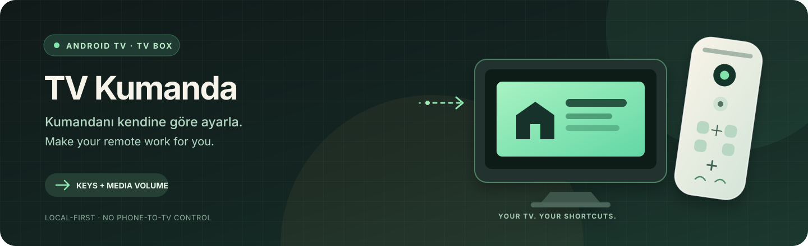

<div align="center">
  
  <h1>TV Kumanda</h1>
  <p><strong>Kumandanı kendine göre ayarla. / Make your remote work for you.</strong></p>
  <p>Android TV & TV box · Yerel tuş eşleme / Local key remapping · Android medya sesi / Android media volume</p>
  <sub>Başlık görseli özgün vektör illüstrasyonudur; gerçek cihaz ekran görüntüsü değildir. / Original vector artwork, not an in-device screenshot.</sub>
</div>

> **Önemli / Important:** Uygulama yalnızca Android'in erişilebilirlik hizmetine ilettiği uygun tuşları yönlendirebilir. Firmware, Android veya üretici tarafından önce tüketilen tuşları geri alamaz. Android medya sesini değiştirebilmek de AUX/optik/HDMI çıkışında sesin mutlaka değişeceği anlamına gelmez.
>
> The app can only route eligible keys delivered to its Android accessibility service. It cannot recover keys consumed earlier by firmware, Android, or the device maker. Changing Android media volume also does not guarantee an audible change on AUX/optical/HDMI outputs.

<p align="center">
  <a href="#turkce">Türkçe</a> · <a href="#english">English</a>
</p>

## Türkçe

TV Kumanda, Android TV ve TV box kumandalarında Android'e ulaşan bazı tuşları seçtiğiniz uygulamalara yönlendiren küçük, yerel bir Android uygulamasıdır. İsteğe bağlı ses modu, öğretilen kumanda ses tuşlarıyla Android'in medya sesini (`STREAM_MUSIC`) değiştirmeyi dener. Telefonla televizyona komut göndermez; TV'nin veya soundbar'ın donanım sesini doğrudan kontrol etmez.

Uygulama arayüzü şu anda Türkçedir; aşağıdaki README hem Türkçe hem İngilizce kullanım bilgisi sunar.

### Neler yapar?

- Uygulamaya ulaşan ve uygulamanın eşlemeye izin verdiği bir fiziksel tuşu seçilen uygulamayı açacak şekilde eşler.
- Her eşleme için isteğe bağlı uygulama istisnaları sunar; eşlemeleri yerel olarak saklar, tek tek silmeye ve sıfırlamaya izin verir.
- Kumandanın ses açma/kısma tuşlarını ayrı ayrı öğretip Android medya sesini ayarlamayı isteğe bağlı olarak dener.
- Android sabit ses politikasını veya değişmeyen medya ses indeksini algılarsa ilgili ses tuşunu Android'e bırakır.
- Eşlenmemiş tuşlar, gezinme ve sistem kontrolleri için normal davranışı korumayı hedefler.

### İlk kurulum

Şu anda indirilebilir bir GitHub sürümü/APK'sı yayımlanmış değil. Kaynaktan denemek için:

1. Android TV box'ta APK'yı oluşturup cihaza aktarın (geliştirici komutları aşağıda).
2. Android isterse kullandığınız dosya yöneticisine bilinmeyen uygulama yükleme izni verin ve APK'yı kurun.
3. **TV Kumanda** uygulamasını açıp kumanda erişilebilirlik hizmetini etkinleştirin.
4. **Yeni tuş eşlemesi** ile bir tuşa basın; açılacak uygulamayı seçip eşlemeyi kaydedin.
5. Ana ekranda ve ilgili uygulamalarda tuşu deneyin. Bir eşleme belirli uygulamalarda devre dışı bırakılabilir.

Erişilebilirlik hizmetini Android ayarlarından istediğiniz zaman kapatabilirsiniz. Android veya üretici dışarıdan yüklenen hizmeti engelliyorsa, aygıta özel **Kısıtlanmış ayarlara izin ver** adımı gerekebilir; menü ve kullanılabilirlik Android sürümüne/OEM'e bağlıdır.

### Android medya sesi

1. Kumandanın ses açma ve ses kısma tuşlarını ayrı ayrı öğretin.
2. Android medya sesi seçeneğini etkinleştirin.
3. Medya oynatırken Android medya ses indeksinin değişip değişmediğini gözlemleyin.
4. Soundbar AUX/optik/SPDIF/HDMI üzerinden bağlıysa, soundbar kazancını sabit tutup duyulan sonucu ayrıca test edin.

`AudioManager` ile `STREAM_MUSIC` ayarlanır; HDMI-CEC, TV sesi veya uygulamanın kendi ses seviyesi ayarlanmaz. Cihazın sabit ses politikası, ses rotası, passthrough yapılandırması ve OEM yazılımı sonucu değiştirebilir. Bağlı çıkış türü listesi, o anda duyulan aktif rotayı veya ses değişikliğini kanıtlamaz. Güvenilir başarı ölçütü, gerçek cihazda sabit soundbar kazancında duyulur bir değişiklik elde etmektir.

### Uyumluluk sınırları

| Durum | Beklenti |
| --- | --- |
| Tuş Android'e ulaşır, erişilebilirlik filtresi tarafından teslim edilir ve eşlemeye uygundur | Eşleme çalışabilir; hedef TV uygulamasının açılışı cihazda doğrulanmalıdır. |
| IR, HDMI-CEC, firmware veya sistem tuşu uygulama hizmetine hiç ulaştırmaz | Uygulama bu tuşu göremez veya yeniden eşleyemez. |
| Korunan gezinme, yazma, güç ya da giriş seçimi tuşları | Uygulama normal kullanımı bozmamak için bunları eşlemeye kapatır. |
| Erişilebilirlik hizmeti OEM/Android tarafından durdurulur ya da kısıtlanır | Tuş yönlendirme durabilir; Android ayarlarında hizmeti kontrol edip gerekirse yeniden etkinleştirin. |
| AUX/optik/SPDIF/HDMI sabit ses veya passthrough rotası | Android indeksindeki değişim duyulan çıkışı değiştirmeyebilir; her cihaz/rota ayrı test edilmelidir. |

Proje `minSdk 21` (Android 5.0) ile derlenir. Bu, her Android TV/box, kumanda veya ses zincirinde çalışma garantisi değildir. Cihazların tuş teslimi ve ses davranışı OEM'e, Android sürümüne ve bağlantı biçimine göre değişir.

### Gizlilik ve erişilebilirlik

- Manifest'te internet izni tanımlı değildir; eşlemeler cihazdaki uygulama tercihleri içinde saklanır.
- Erişilebilirlik hizmeti yalnızca teslim edilen tuş olaylarını filtrelemek üzere bildirilmiştir; ekran içeriğini alma yeteneği kapalıdır (`canRetrieveWindowContent=false`).
- Hizmeti açmak kullanıcı eylemi gerektirir. Android ayarlarından kapatılabilir.
- Erişilebilirlik izni hassastır. Hizmeti yalnızca beklediğiniz uygulamaya verin; davranışını cihazınızda test edin.

### Test ve cihaz doğrulaması

Yerel doğrulama: **30 birim/entegrasyon testi geçti**, Android lint **0 bulgu** ve release derlemesi başarılı. Bu otomatik kontroller üretici firmware'ini veya gerçek ses çıkışını doğrulamaz. Gerçek Android TV/box, kumanda ve soundbar üzerinde test bu ortamda yapılmadı.

Kendi cihazınızda D-pad/OK/geri tuşlarını, eşlenmiş ve hariç tutulan uygulamaları, basılı tutma/tekrar davranışını ve yeniden başlatma sonrası hizmeti deneyin. Ses için üç şeyi ayrı ayrı doğrulayın: fiziksel olay hizmete geliyor mu, Android medya indeksi değişiyor mu, sabit soundbar kazancında duyulan ses değişiyor mu?

### İndir / kur

Henüz GitHub Release veya imzalı dağıtım APK'sı yok. Kaynaktan üretmek için:

```powershell
.\gradlew.bat :app:assembleRelease
```

APK yolu: `app/build/outputs/apk/release/app-release.apk`. Mevcut yapı yerel Android debug anahtarıyla imzalanır; Play Store veya genel dağıtım anahtarı değildir. Bu APK ile sonraki güncellemelerin aynı anahtarla imzalanması gerekir.

> **Lisans:** Depoda şu anda `LICENSE` dosyası yok. Depoyu herkese açık yapmak, kodu yeniden kullanma veya dağıtma lisansı vermiş sayılmaz. Kullanım ve katkı şartları lisans seçimi yapılana kadar belirtilmemiştir.

### Geliştirici notları

- Kotlin ve yerel Android Views; uygulama sürümü `1.0`.
- `compileSdk` / `targetSdk` 37; `minSdk` 21.
- Android Gradle Plugin 9.5.3, Kotlin Gradle Plugin 2.4.21; Gradle wrapper 9.9.2.
- Kotlin'in belgelenmiş tam uyumluluk aralığı Gradle 9.7.0'a kadar uzanır. Bu depoda Gradle 9.9.2 ile test, lint ve release derlemesi doğrulanmıştır; 9.9.2 bu nedenle burada doğrulanmış, ancak KGP'nin belgelenmiş tam destek aralığının dışındadır.
- JDK 17+, Android SDK Platform 37 ve Android Build Tools 36.0.0 gerekir. SDK yolunu `local.properties` içindeki `sdk.dir` ile veya `ANDROID_HOME` ile belirtin.

```powershell
.\gradlew.bat :app:testDebugUnitTest :app:lintDebug :app:assembleRelease
```

## English

TV Kumanda is a small, local Android app for routing selected remote-control keys that reach Android on Android TV and TV boxes. Its optional volume mode tries to adjust Android media volume (`STREAM_MUSIC`) using the learned remote volume keys. It does not send commands to a TV from a phone, nor directly control a TV or soundbar's hardware volume.

The in-app interface is currently Turkish; this README provides usage information in both Turkish and English.

### What it does

- Maps an eligible physical key delivered to the app to launch a selected app.
- Supports per-mapping app exclusions, local persistence, removing individual mappings, and reset.
- Optionally learns the remote's volume-up and volume-down keys separately and tries to adjust Android media volume.
- Passes a volume key back to Android when the device reports a fixed-volume policy or the media-volume index does not change.
- Aims to preserve normal behavior for unmapped keys, navigation, and system controls.

### Getting started

There is no downloadable GitHub release/APK yet. To try it from source:

1. Build the APK and transfer it to your Android TV box (developer commands are below).
2. If Android asks, allow the file manager you use to install unknown apps, then install the APK.
3. Open **TV Kumanda** and enable its remote-control accessibility service.
4. Choose **New key mapping**, press a key, select the app to open, and save the mapping.
5. Try the key on the home screen and in the relevant apps. A mapping can be disabled for selected apps.

You can turn the accessibility service off in Android Settings at any time. If Android or the device maker blocks a sideloaded service, a device-specific **Allow restricted settings** step may be required; its availability and wording depend on Android and the OEM.

### Android media volume

1. Learn the remote's volume-up and volume-down keys separately.
2. Enable the Android media-volume option.
3. While media is playing, observe whether Android's media-volume index changes.
4. For a soundbar connected over AUX/optical/SPDIF/HDMI, keep its gain fixed and test the audible result separately.

The app adjusts `STREAM_MUSIC` through `AudioManager`; it does not adjust HDMI-CEC, TV volume, or an app's own volume. Fixed-volume policies, audio routing, passthrough configuration, and OEM software can change the result. A list of connected output types does not prove which route is actively audible or that volume changed. The meaningful success criterion is an audible change on the real device while the soundbar gain stays fixed.

### Compatibility boundaries

| Situation | Expectation |
| --- | --- |
| Android delivers an eligible key to the accessibility filter | The mapping may work; verify that the target TV app launches on the device. |
| IR, HDMI-CEC, firmware, or a system component never delivers the key to the app service | The app cannot see or remap that key. |
| Protected navigation, typing, power, or input-selection key | The app excludes it from mapping to preserve normal use. |
| Android/OEM stops or restricts the accessibility service | Routing may stop; check the service in Android Settings and re-enable it if needed. |
| AUX/optical/SPDIF/HDMI fixed-volume or passthrough route | An Android index change may not alter audible output; test each device and route separately. |

The project builds with `minSdk 21` (Android 5.0). This is not a guarantee of operation on every Android TV/box, remote, or audio chain. Key delivery and audio behavior vary by OEM, Android version, and connection type.

### Privacy and accessibility

- The manifest declares no internet permission; mappings are stored in the app's local preferences.
- The accessibility service is declared to filter delivered key events; access to window content is disabled (`canRetrieveWindowContent=false`).
- Enabling the service requires user action. It can be turned off in Android Settings.
- Accessibility access is sensitive. Grant it only to an app you trust and verify its behavior on your device.

### Testing and device verification

Local verification: **30 unit/integration tests passed**, Android lint reported **0 findings**, and the release build succeeded. These automated checks do not verify OEM firmware or real audio output. No physical Android TV/box, remote, or soundbar was available for testing here.

On your device, test D-pad/OK/back, mapped and excluded apps, press-and-hold/repeat behavior, and service recovery after reboot. For audio, verify these separately: does the physical event reach the service, does the Android media index change, and does audible output change with soundbar gain held fixed?

### Download / install

There is no GitHub Release or generally distributed signed APK yet. Build from source:

```powershell
.\gradlew.bat :app:assembleRelease
```

APK path: `app/build/outputs/apk/release/app-release.apk`. The current build is signed with the local Android debug key; it is not a Play Store or general distribution signing key. Future updates to an installation using this APK must use the same signing key.

> **License:** There is currently no `LICENSE` file in the repository. Making the repository public does not grant a license to reuse or redistribute the code. Usage and contribution terms remain unspecified until a license is selected.

### Developer notes

- Kotlin and native Android Views; app version `1.0`.
- `compileSdk` / `targetSdk` 37; `minSdk` 21.
- Android Gradle Plugin 9.5.3, Kotlin Gradle Plugin 2.4.21, Gradle wrapper 9.9.2.
- Kotlin's documented full-support range extends through Gradle 9.7.0. Tests, lint, and the release build were validated in this repository with Gradle 9.9.2; that version is validated here but outside KGP's documented full-support range.
- JDK 17+, Android SDK Platform 37, and Android Build Tools 36.0.0 are required. Set the SDK path with `sdk.dir` in `local.properties` or `ANDROID_HOME`.

```powershell
.\gradlew.bat :app:testDebugUnitTest :app:lintDebug :app:assembleRelease
```
